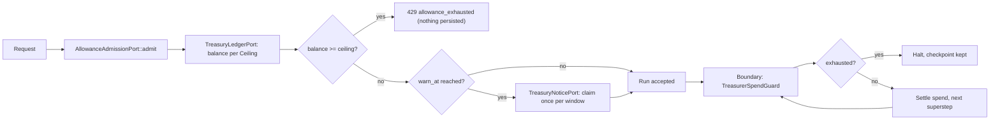

# Treasurer

The `Treasurer` is the spend-governance officer of the token economy -- "what this tenant or key
may spend, and when the next call stops". It sits beside the [Commissary](commissary.md), which
rations one call's input window, and Cadence, which paces calls after a provider says slow down
(see [Rate pacing (Cadence)](#rate-pacing-cadence) below). The Treasurer ships in the facade
crate `paladin-ai` (`src/application/services/treasurer/`, path
`paladin::application::services::treasurer`); its three ports live in `paladin-ports`.

The name was reserved by [ADR-0050](https://github.com/DF3NDR/paladin-dev-env/blob/main/.planning/decisions/0050-treasurer-reservation.md)
for cross-run spend governance and built in v0.11.0 (Phases 38-43: pricing, ledger, admission,
mid-run halt, pacing); Phases 50-51 extended what it meters. The design records are linked under
[See also](#see-also) and indexed on the [Architecture Decisions](../contributing/adr-index.md) page.

## Concept

The Treasurer keeps three responsibilities deliberately separate:

- **`TreasuryLedgerPort` -- the ledger.** Every draw on an allowance is an immutable, append-only
  row (reserve, settle, release); a scope's balance is derived on read as a plain sum, never
  stored and updated. Settlement is idempotent by a store-enforced key, so a redelivered or
  resumed run is charged once per genuine attempt. Amounts are whole nano-units of one currency.
  ([ADR-0053](https://github.com/DF3NDR/paladin-dev-env/blob/main/.planning/decisions/0053-ledger-balance-model.md))
- **`AllowanceAdmissionPort` -- admission.** An `AllowancePolicy` holds per-scope `ScopeAllowance`
  entries (one per tenant or API key, each with a window amount and an optional lifetime cap).
  Windows are tumbling and aligned to the UTC epoch, computed by `window_for` from the ledger's
  own clock. Before a run or agent call is accepted, the Treasurer reads the balance for each
  `Ceiling` that applies to the caller; a balance at or above a ceiling is refused
  `429 allowance_exhausted` before anything is persisted. Admission is a check, never a hold.
  ([ADR-0056](https://github.com/DF3NDR/paladin-dev-env/blob/main/.planning/decisions/0056-allowance-admission-model.md))
- **`TreasurerSpendGuard` -- mid-run enforcement.** At each superstep boundary of the run engine,
  and after each model response in the agent loop, the same ceiling evaluation runs again. The
  next boundary after a ceiling is reached halts the run resumably with its checkpoint kept; a
  ledger that cannot be read halts the run too (`ledger_unavailable`), never a silent continue.
  An agent-kind run whose model has no price row when the worker dispatches it halts with
  `model_unpriced` beside `ledger_unavailable`, and the model is not called.
  ([ADR-0052](https://github.com/DF3NDR/paladin-dev-env/blob/main/.planning/decisions/0052-mid-run-treasurer-enforcement.md),
  [ADR-0057](https://github.com/DF3NDR/paladin-dev-env/blob/main/.planning/decisions/0057-mid-run-halt-contract.md))

**Framework owns metering and enforcement; operators own policy.** The Treasurer never decides how
much a tenant should be allowed -- that is the operator's `treasurer.allowance` configuration. It
fails closed: a principal with a ceiling whose balance cannot be read is not admitted; a metered
principal calling an agent on an unpriced model is refused (`422 model_unpriced`); a currency
change fails admission closed until the ledger is migrated. It takes identity only -- tenant and
API key name, never a role -- so no role, admin keys included, bypasses an allowance.

Every guarantee is bounded, none is absolute. The boundary check runs after a superstep, so a run
can spend at most one top-level superstep beyond a ceiling (a nested child graph is part of the
superstep that hosts it); the agent loop compares after a response, so it can overshoot by at most
one model response; a single streamed call is one provider call; and two runs admitted in the same
instant can each start. Windows tumble rather than slide, so a scope can spend up to twice an
allowance across one boundary. This page does not promise an allowance can never be overspent.

## The model

| Type | Purpose |
|---|---|
| `Treasurer` | The facade service: an `AllowancePolicy` evaluated over a `TreasuryLedgerPort`. Answers `AllowanceAdmissionPort`, derives the agent loop's token budget when a price table is attached, and claims once-per-window notices when a notice store is attached. |
| `AllowancePolicy` | The resolved policy built once at boot from `treasurer.allowance`: per-API-key and per-tenant allowances in one currency, plus the default warn threshold. A principal with no entry yields no ceiling and never reaches the ledger. |
| `ScopeAllowance` | One scope's configured allowance: a window ceiling over a period in seconds, an optional lifetime cap and an optional warn-threshold override, all in integer nano-units. |
| `Ceiling` | One evaluated limit: scope kind, limit kind (window or lifetime), tenant, optional API key, optional period, the ceiling in nano-units and the warn percent. A balance at or above `ceiling_nanos` is exhausted. A principal yields up to four, always in the order API-key window, API-key lifetime, tenant window, tenant lifetime. |
| `TreasurerSpendGuard` | The per-run `SpendGuard` the engine consults at each boundary. Check-only, never caches a `Continue`, fails closed, and makes its first halt sticky across a run's clones. |
| `OperatorNoticeTarget` | Where an operator allowance notice is delivered: the operator's webhook URL and the durable delivery queue the notice is enqueued onto. Carries no signing secret; `Debug` prints the URL only. |
| `window_for` | `window_for(now, period_secs)` returns the half-open UTC-epoch-aligned window `[start, end)` that contains `now`, or `None` for a zero period or an unrepresentable instant -- never a panic. |
| `AllowanceAdmissionPort` | The input port `paladin-web` and the run-submission service call before a run or agent call is accepted. Core-typed only; refusals precede every write; a failed read is an error, never an admission. |
| `TreasuryNoticePort` | Records, reads back and releases the durable once-per-window notice a warn-threshold crossing produces. Deduplication is a store-enforced constraint, and the port knows no policy. |
| `TreasuryLedgerPort` | The whole contract every ledger backend (in-memory, SQLite, Postgres) implements: reserve, settle, release, balance and the store clock. Append-only, derive-on-read, policy-free. |

This page names exactly this surface -- no more. The configuration structs under `treasurer:` are
documented in the [Treasurer configuration reference](../getting-started/configuration.md#treasurer),
not here.

## Flow



## Pricing as the cost source

The operator's price table (`treasurer.pricing`) is what turns a call's token usage into a cost the
ledger can hold. A call's cost is rounded exactly once, half-up, to the nearest nano-unit over the
summed axis products, not once per axis. A model with no row stays unpriced: its cost is `None`
and one warning is logged per model name, and a principal with a ceiling that calls an agent on
such a model is refused `422 model_unpriced`. The key format, the numeric limits and the unpriced
cases are in the [Treasurer pricing](../getting-started/configuration.md#treasurer-pricing)
reference.

**Boot warning.** At boot, when an allowance is configured, the server logs one warning under the
log target `paladin::pricing` for every code-registered agent model and every stored agent-kind
assistant model that has no row. Every stored version of each agent-kind assistant present at
boot is checked, including pinned older ones, because a run or schedule can pin any version.
Boot continues, and workflow assistants are not refused. The warning does not check workflow
graph-node models (the assistant resolver cannot list them), agents provisioned at runtime, or
agent-kind assistants or versions created after boot. Graph-node pricing
coverage is an accepted, documented gap (`.planning/WINDOWS.md` row 67), so price every model a
graph can reach. One line looks like this:

```text
model `example-model` is reachable by a metered principal but has no treasurer.pricing row: agent-kind calls on it are refused at admission (422 model_unpriced) or halted at dispatch (model_unpriced); workflow assistants are not refused; every stored version (including pinned older ones) of the agent-kind assistants stored at boot is checked, but workflow graph-node models, runtime-provisioned agents and agent-kind assistants or versions created after boot are not checked here -- add a treasurer.pricing row for it
```

## Rate pacing (Cadence)

Cadence is the one who sets the marching pace. It paces calls per (provider, model) after a
provider answers `429 Too Many Requests`, in process or fleet-wide through Redis. It is reactive
only -- nothing is gated until a provider says slow down -- and the `429` itself is surfaced to the
caller unchanged, never retried inside the pacing layer. It is not spend control: it never reads
the ledger and never refuses a call for cost. It lives in `paladin-llm` and is configured under
`treasurer.cadence`. The decision record is
[ADR-0058](https://github.com/DF3NDR/paladin-dev-env/blob/main/.planning/decisions/0058-rate-pacing-cadence.md);
the keys, defaults and rollout notes are in the
[Cadence reference](../getting-started/configuration.md#treasurer-rate-pacing-cadence).

## Usage sketch

The block below is fenced `rust,ignore` rather than a live doc test: the ledger it reads is
supplied by the caller (a `TreasuryLedgerPort` implementation, the in-memory one for tests), and
the worked scenario needs a ledger already holding spend at the ceiling, which the module's own
`FakeLedger` (a test-only helper in `tests.rs`) scripts. The module's rustdoc carries the live
doc tests for each type.

A tenant ceiling reached at admission, mirroring
`src/application/services/treasurer/tests.rs:213-256` (the `usd`, `subject` and `key_policy`
helpers) and `tests.rs:293-312`
(`balance_at_the_ceiling_is_refused_with_the_window_figures`), with the window from
`src/application/services/treasurer/window.rs:32`:

```rust,ignore
use std::sync::Arc;
use chrono::{TimeZone, Utc};
use paladin::application::services::treasurer::{
    AllowancePolicy, ScopeAllowance, Treasurer, window_for,
};
use paladin_core::platform::container::cost::CurrencyCode;
use paladin_core::platform::container::principal::{RunAttribution, TenantId};
use paladin_ports::input::allowance_admission_port::{AdmissionError, AllowanceAdmissionPort};

// One tenant ceiling: 2.5 units per hour (amounts are nano-units), warning at 80 percent.
let policy = AllowancePolicy::new(CurrencyCode::new("USD")?, 80)
    .with_tenant("acme", ScopeAllowance::new(3_600, 2_500_000_000));
let treasurer = Treasurer::new(policy, /* ledger: Arc<dyn TreasuryLedgerPort> */ ledger);
let subject = RunAttribution::new(TenantId::new("acme")?, "svc-a");

// The window a 13:30 balance read covers: 13:00:00 (inclusive) to 14:00:00 (exclusive) UTC.
let now = Utc.with_ymd_and_hms(2026, 10, 3, 13, 30, 0).single().ok_or("bad instant")?;
let (start, end) = window_for(now, 3_600).ok_or("no window")?;

match treasurer.admit(&subject, None).await {
    Ok(admission) => {
        // admitted; admission wrote nothing to the ledger
    }
    Err(AdmissionError::Refused(refusal)) => {
        // the tenant's balance reached the ceiling in [start, end)
        // refusal.window == Some((start, end)); refusal.retry_after_secs() is Some(..)
    }
    Err(AdmissionError::Backend { message }) => {
        // the ledger could not be read: fail closed, the request is not admitted
    }
    Err(AdmissionError::ModelUnpriced { model }) => {
        // only from admit_for_model: no treasurer.pricing row for `model`
    }
}
```

## HTTP contract

The refusal a caller sees, `429 allowance_exhausted`, is defined in
[Allowance refusals](../api-reference/platform-api.md#allowance-refusals), and the signed
`allowance_warning` webhook an operator receives in
[Operator allowance notices](../api-reference/platform-api.md#operator-allowance-notices); the
payloads are not repeated here. The operator webhook URL passes the same address guard as run
webhooks, at boot and again at send time, and a private address needs `webhooks.allow_private:
true`. DNS rebinding is a documented limitation of that guard: it does not pin the resolved
address between the check and the connection, so this page does not claim protection against it.
The webhook signing secret is supplied only through the environment variable
`APP_TREASURER_ALLOWANCE_WEBHOOK_SECRET`; it never belongs in a configuration file.

## See also

- [Treasurer configuration reference](../getting-started/configuration.md#treasurer) -- every
  `treasurer:` key with its type, default, validation rule and environment override.
- [Commissary](commissary.md) -- the input-side officer: per-call window rationing.
- [Architecture Decisions](../contributing/adr-index.md) -- the index these records appear in.
- [ADR-0050](https://github.com/DF3NDR/paladin-dev-env/blob/main/.planning/decisions/0050-treasurer-reservation.md)
  -- the name and role reserved.
- [ADR-0052](https://github.com/DF3NDR/paladin-dev-env/blob/main/.planning/decisions/0052-mid-run-treasurer-enforcement.md)
  -- where mid-run enforcement attaches.
- [ADR-0053](https://github.com/DF3NDR/paladin-dev-env/blob/main/.planning/decisions/0053-ledger-balance-model.md)
  -- the append-only, derive-on-read ledger.
- [ADR-0056](https://github.com/DF3NDR/paladin-dev-env/blob/main/.planning/decisions/0056-allowance-admission-model.md)
  -- tumbling UTC windows and check-only admission.
- [ADR-0057](https://github.com/DF3NDR/paladin-dev-env/blob/main/.planning/decisions/0057-mid-run-halt-contract.md)
  -- the mid-run halt contract.
- [ADR-0058](https://github.com/DF3NDR/paladin-dev-env/blob/main/.planning/decisions/0058-rate-pacing-cadence.md)
  -- rate pacing (Cadence).
